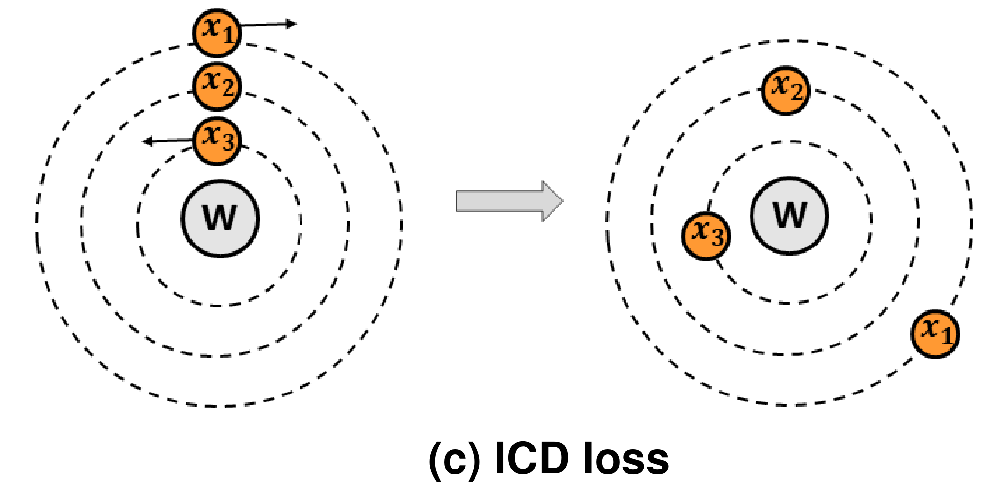
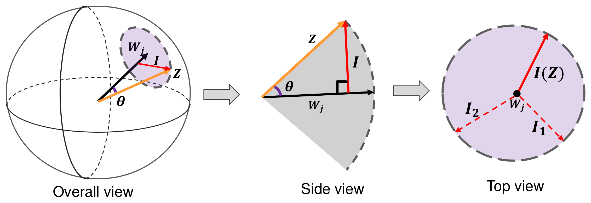

# Intra-Class Diversity Loss for Person Re-Identification

**Wei Zhou, BaXian Chen** · arXiv preprint, 2026

[](https://arxiv.org/abs/2611.30707)
[Paper (PDF)](https://arxiv.org/pdf/2611.30707) · [Training code](https://github.com/321zhou-zhou/ICD-Loss-ReID-Training)

This repository provides a standalone PyTorch implementation of **Intra-Class Diversity (ICD) loss**, together with a minimal CPU demo. It is intended for readers who want to understand the core method and integrate it into their own models without downloading a complete ReID training framework.

**ICD-specific contribution:** Wei Zhou proposed the core idea, derived the loss formulation, and implemented it in PyTorch.

## Core idea

Person ReID must generalize to identities unseen during training, often with large intra-class variation. Instead of simply enforcing intra-class compactness, ICD aims to **maximize intra-class differences in classification-irrelevant directions**.

### Intuition

<p align="center">
  
</p>

*Figure 1(c) of the paper.* ICD encourages same-identity representations to differ in their class-orthogonal directions, rather than simply pushing them farther away from their corresponding class weight. The circles illustrate different angles to the target class-weight vector; the diagram illustrates the intended geometry, not an exact constraint on the learned features during training.

### Geometric formulation

<p align="center">
  
</p>

*Geometric interpretation of ICD (Figure 5 of the paper).* The overall and side views show the decomposition of a normalized feature into its class-weight-aligned and orthogonal components. The top view illustrates different orthogonal directions for samples of the same identity.

For a normalized feature $\mathbf{z}$ and its normalized target class weight $\mathbf{w}_y$, the orthogonal component is

$$
\mathbf{i}=\mathbf{z}-(\mathbf{w}_y^\top\mathbf{z})\mathbf{w}_y.
$$

The released implementation normalizes these components and averages positive cosine similarities between distinct same-identity samples. Minimizing this term encourages diversity in the class-orthogonal space. The class weights and target cosine values are detached in the ICD branch. Cross-entropy (CE) remains responsible for identity discrimination. 
## Quick start

```bash
git clone https://github.com/321zhou-zhou/ICD-Loss-ReID-Code-Sample.git
cd ICD-Loss-ReID-Code-Sample
pip install -r requirements.txt
python demo.py
```

The demo uses synthetic features and labels and runs a forward/backward pass on CPU. No dataset, pretrained weights or GPU is required.

```python
import torch
import torch.nn.functional as F
from icd_arcface import ICDArcFace

features = torch.randn(8, 128, requires_grad=True)
labels = torch.tensor([0, 0, 1, 1, 2, 2, 3, 3])

classifier = ICDArcFace(in_features=128, out_features=4)
logits, icd_loss, class_weights = classifier(features, labels)

loss = F.cross_entropy(logits, labels) + 0.1 * icd_loss
loss.backward()
```

`ICDArcFace` returns classification logits, a scalar ICD loss, and the normalized class weights selected by the labels. ICD can also complement existing metric learning losses. It is used during training only.

## Repository contents

- [`icd_arcface.py`](icd_arcface.py): ICD-enhanced ArcFace classification layer.
- [`demo.py`](demo.py): minimal CPU forward/backward example.
- [`requirements.txt`](requirements.txt): PyTorch dependency.

For model training, dataset configurations and reported benchmark results, see the [companion training repository](https://github.com/321zhou-zhou/ICD-Loss-ReID-Training). This sample is not a benchmark reproduction package.

## Citation

```bibtex
@misc{zhou2026icd,
  title         = {Intra-Class Diversity Loss for Person Re-Identification},
  author        = {Zhou, Wei and Chen, BaXian},
  year          = {2026},
  eprint        = {2611.30707},
  archivePrefix = {arXiv},
  primaryClass  = {cs.CV},
  url           = {https://arxiv.org/abs/2611.30707}
}
```
